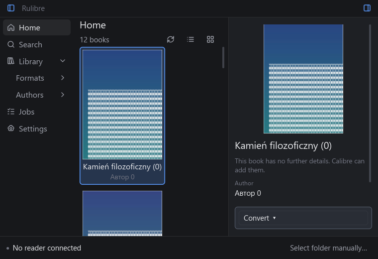

# Rulibre

I got tired of Calibre's old, complex interface and its heavy storage footprint. All I really needed was a way to browse my library and transfer books to my e-reader, so I built a lightweight, drop-in replacement that works with your existing Calibre library structure. I also added things I found lacking or too complicated to use in Calibre, like instant book search.


## Install

The easiest way to get Rulibre is from [crates.io](https://crates.io/crates/rulibre):

```
cargo install rulibre
rulibre
```

This installs the **TUI** (terminal) version. Conversion requires external tools; browsing and sending an existing compatible file do not. The GUI version is source-only (see [Build from source](#build-from-source)). These crates.io instructions refer to the upstream release; build this checkout to use the core changes documented below.

On first run, you'll be prompted for your Calibre library path. The path is saved to your system default config path.

### Uninstall

```
cargo uninstall rulibre
```

## Desktop UI (iced, in development)

A native desktop client built with [iced](https://iced.rs) lives in `crates/rulibre-ui`. It will replace the Tauri/Leptos GUI; until then both are in the repository. It browses the library as a list or a cover grid, searches live, shows metadata, converts, and sends books to a connected reader with a progress bar and a queue. The Calibre library stays read-only.



Run it from a checkout (Rust 1.93.1; on Linux install the Wayland/X11, xkbcommon and Vulkan development packages listed in [`.github/workflows/ui.yml`](.github/workflows/ui.yml)):

```
cargo run -p rulibre-ui --release
```

- **Platforms:** built, linted and tested in CI on Windows, Ubuntu 24.04 and macOS. It has only been run by hand on Windows 11. Window blur is Windows-only; other systems get an opaque window.
- **External tools:** none to browse, search or send an existing compatible file. Conversion needs Calibre's `ebook-convert` and/or [kepubify](https://pgaskin.net/kepubify/).
- **Keyboard:** `/` search, arrows move, Shift extends, Ctrl+A selects all, `T` sends, `C` opens Convert, Ctrl+B / Ctrl+I toggle the panes, Esc closes or clears.
- **Not supported:** MTP and network readers, a light theme, metadata editing. No physical reader has been tested with this UI.

Architecture, module map, how to add a screen, tests and the full list of limitations: [docs/UI.md](docs/UI.md). Manual checklist and results: [docs/UI_CHECKLIST.md](docs/UI_CHECKLIST.md).

## Features

- Browse all books in your Calibre library sorted by author and title
- Search/filter with `/` across author, title, and format
- Detail panel showing metadata parsed from `metadata.opf` (title, author, publisher, date, language, series, tags, description, identifiers)
- Convert books between formats (`c` key) using [kepubify](https://pgaskin.net/kepubify/) or Calibre's `ebook-convert`
- Send books to a connected e-reader (`t` key) — auto-detects Kobo and Kindle mounts
- Mouse support: click to select books, scroll both panels
- Keyboard focus switching between table and detail panels

## What gets scanned

The scanner walks `{library}/{author}/{title (id)}/` directories and recognizes AZW3, DOCX, EPUB, KEPUB, MOBI, PDF and TXT. Extensions are case-insensitive; `.kepub.epub` is distinct from EPUB. Unknown formats (including CBZ), covers, OPF and temporary files are not book inputs. Each book has a stable ID and an ordered list of exact file paths.

Excluded from scanning:
- `.caltrash/`, `.calnotes/`, `.DS_Store`, `downloaded/` (Calibre internal)
- `metadata.opf`, `cover.jpg` inside book folders

## Book conversion

Press `c` on a selected book to convert it to another format. Conversion options are shown based on which tools are installed:

- **kepubify** — used for EPUB → KEPUB conversion. Install from [pgaskin.net/kepubify](https://pgaskin.net/kepubify/)
- **ebook-convert** (Calibre) — used for other supported routes. KEPUB output is offered only when the installed tool's capability probe succeeds. Included with [Calibre](https://calibre-ebook.com/)

Only formats you don't already have are offered. If neither tool is installed, the convert dialog will let you know.

The Calibre library is read-only: Rulibre never imports conversions into it or changes `metadata.db`, OPF, covers or source books. Conversion results live in a separate temporary workspace owned by the application; retain/export them before exiting if needed. Explicit core output directories must be outside the library. Existing output files produce a conflict error.

## Readers and core API

Detection enumerates mounted local filesystems on Windows, Linux and macOS and checks reader signatures. A volume label or a `documents` directory alone does not identify a reader. Kobo prefers existing KEPUB, then EPUB; Kindle prefers AZW3, then MOBI and can prepare AZW3 using Calibre. MTP and network storage are unsupported.

The core supports explicit selection by device ID and `device::manual_device(path, kind)` for a validated mount root. Existing clients automatically select a single recognized reader; they do not yet expose a manual selection screen. Multiple readers without a prior selection require explicit selection through the core API.

Transfers copy into a temporary file on the destination and publish without overwriting. Cancellation and write failures are reported; if disconnection prevents cleanup, the error includes the partial file path. Root mount points are never recreated.

Core operations return typed `Error`/`ErrorKind`; scans separate root errors from per-book warnings. Missing OPF uses directory metadata, while corrupt OPF is an error. `JobExecutor` runs scans, metadata, conversion and transfers on bounded worker threads, exposes job IDs, states and events, and supports cancellation. Copy progress reports bytes; converter progress reports stages. Shutdown cancels work and joins workers, but may wait for an uninterruptible OS call.

API contracts: [formats](docs/BOOK_FORMATS.md), [configuration](docs/CONFIG_PATHS.md), [metadata](docs/METADATA.md), [read-only library](docs/LIBRARY_READ_ONLY.md), [conversion](docs/CONVERSION.md), [devices and manual selection](docs/DEVICE_DETECTION.md), [preparation](docs/READER_PREPARATION.md), [safe transfer](docs/SAFE_TRANSFER.md), [errors](docs/CORE_ERRORS.md), [jobs](docs/BACKGROUND_JOBS.md), [client integration](docs/CLIENT_INTEGRATION.md).

## Verification

With Rust 1.93.1, the WASM target and native Tauri build dependencies installed:

```powershell
pwsh -File scripts/check-readiness.ps1 -WasmIpc
```

`-WasmIpc` requires Node.js and `wasm-bindgen-cli` 0.2.108 (matching Cargo.lock). `-RealConverters` additionally tests installed Calibre with a synthetic TXT → EPUB → KEPUB conversion. Core/TUI tests, strict Clippy, host tests, WASM checks and native volume enumeration run in the Windows/Linux/macOS CI matrix. The iced UI has its own workflow (`ui.yml`: build, Clippy, tests with a headless UI simulator and real-core send/cancel/conflict flows) on the same three systems; locally run `pwsh scripts/check-ui.ps1`. Host checks use temporary build resources; they do not verify GUI packaging or a running WebView. See the [final readiness report](docs/READINESS.md) for actual results and unverified hardware/platform limitations.

## Build from source

Rulibre ships these frontends from a single workspace:

- **TUI** — the ratatui terminal interface, published on crates.io
- **GUI** — Tauri 2 + Leptos desktop window (source-only)
- **iced UI** — the native desktop client described [above](#desktop-ui-iced-in-development) (`cargo run -p rulibre-ui`)

### TUI

```
cargo install --path crates/rulibre
```

Or run directly from a checkout:

```
cargo run -p rulibre
```

### GUI

Prerequisites:

```
rustup target add wasm32-unknown-unknown
cargo install --locked trunk
cargo install --locked tauri-cli --version "^2"
```

Development build:

```
cd crates/rulibre-gui
cargo tauri dev
```

Release build:

```
cd crates/rulibre-gui
cargo tauri build
```

## Extra tools

A diagnostic binary is included for checking unrecognized metadata tags:

```
cargo run --bin scan_metadata -- /path/to/calibre/library
```
