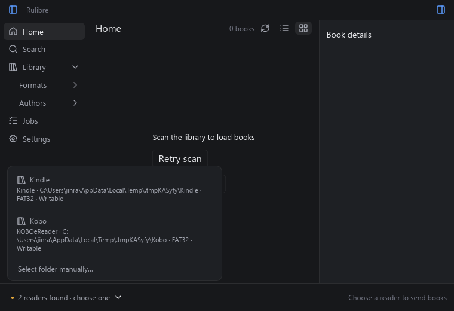
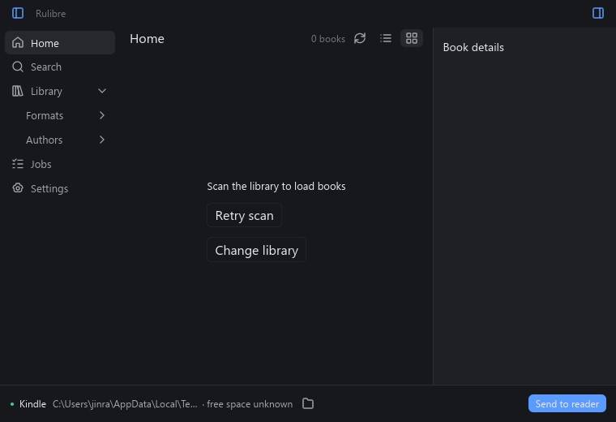
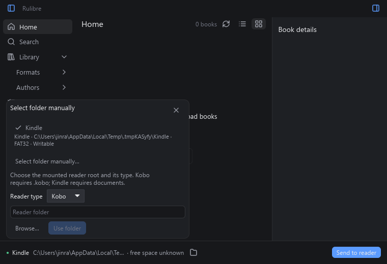

# Device bar — UI item 10

Implemented and checked on Windows, 12 October 2026. The user approved G4's
reader-name dropdown with a fixed-size SVG chevron. They view the HTML mockup
in their own browser; do not start a web server for further mockup reviews.

## Runtime and selection

`services/devices.rs` bridges core `DeviceWatcher::start_with` into a stable
iced subscription through `iced::stream::channel`. Detection, manual-root
revalidation and space queries run on the watcher thread every two seconds.
The main application adds the subscription at startup, including on Setup.

A sole reader is selected automatically. Several readers never pick an arbitrary
first destination. Explicit selection survives while its ID is present; changes
to its path, label or read-only flag refresh the descriptor. Poll failure clears
the list and selection; recovery with several readers requires a new choice.
Warnings/failures have short bar text and full tooltips; toasts belong to item 11.

Space refreshes every poll even when the tracker suppresses an unchanged
snapshot. Values are keyed by ID and mount path. Long paths alone are abbreviated,
so the capacity value or `free space unknown` stays visible.

Publish returns false when its receiver closes. A guard stops and joins the
worker when the iced stream is dropped. Service shutdown also stops it before
joining jobs; repeated shutdown is safe. An in-flight OS filesystem query cannot
be interrupted, so join waits for it to return, as in the core.

## Picker and manual destination

With several readers, clicking the name/chevron opens the list upward from the
left of the bar. Entries show kind, label, root, filesystem and read-only state;
the active entry has a checkmark. Outside click or Escape dismisses it. A sole
reader has plain name text with a manual-folder icon; the disconnected bar has
a manual-folder action.

Manual selection uses the native async folder dialog or an entered path, plus a
Kobo/Kindle selector. `device::manual_device` validates an actual mounted local
filesystem root with the required `.kobo`/`documents` layout, excluding Calibre
libraries, MTP destinations and read-only roots. It creates no files. Accepted
manual roots are revalidated against fresh volume snapshots on every poll and
remembered only for the session. Request generations reject late replies after
dismissal or exit; feed revisions reject polls started before a new manual choice.

Send is rendered and enabled only for a writable selected reader and selected
books. It does not enqueue a job yet; sending belongs to item 11.

## Free-space API

`rulibre_core::volumes::free_space(&Path) -> Result<u64, Error>` returns available
bytes for the calling user on the filesystem containing an existing directory.
It performs metadata/OS queries only, never a write probe. Zero bytes is valid.
The value is advisory and does not reserve transfer space.

Windows uses the caller-available output of
[GetDiskFreeSpaceExW](https://learn.microsoft.com/en-us/windows/win32/api/fileapi/nf-fileapi-getdiskfreespaceexw),
which respects quotas. Unix uses `f_bavail * f_frsize` from
[statvfs](https://www.man7.org/linux/man-pages/man3/statvfs.3.html), excluding
privileged reserved blocks; overflow returns an I/O error. Existing platform
dependencies suffice; no new lockfile entries are needed.

## Verification

Three core tests cover a real temporary Unicode directory query with unchanged
library bytes, invalid paths, injected OS errors and valid zero/large results.
Six new UI tests cover worker/model and app messages: core folder classification,
connect/disconnect/replace/path changes, multiple readers and selection, warnings,
poll failure/recovery, read-only state, space refresh/stale paths, manual
validation/stale replies, closed receiver and running iced-stream cancellation.
Stop assertions verify join, no worker-owned feed references and no further polls.
These use injected volume snapshots and temporary folders, not physical readers.

Passed default-workspace locked all-target Clippy with warnings denied and locked
tests (110 passed, three ignored); `scripts/check-ui.ps1` (workspace formatting,
locked UI build, all-target Clippy/tests: 57 library tests plus one spike test);
and `git diff --check`. Cargo checks ran outside the Windows filesystem sandbox
because its canonicalization restrictions prevent normal checks.

Native reproduction, without a web server:

```powershell
cargo run -p rulibre-ui --example devices_probe --locked
```

The Windows example creates isolated reader folders, classifies them via the
core's injected volume API, drives app messages, saves ten 760×520 screenshots
under `docs/ui-item-10`, and exits. It does not use user settings or access a
Calibre library. Dropdown/manual/warning/read-only/unknown-space layouts were
inspected. Screenshots exercise rendering via messages; the real watcher and
stream lifecycle are exercised separately by the tests.







## Limits

No physical reader, actual mounted-reader selection, physical mouse/keyboard or
native folder-dialog interaction was verified. Higher DPI and Linux/macOS
execution are unverified; Unix free-space code was not run on this host.
Core names reflect kind (Kobo/Kindle), not individual hardware model. Transfers,
progress/cancellation and full toast diagnostics belong to item 11. No commit,
PR or remote CI run was created for item 10.
