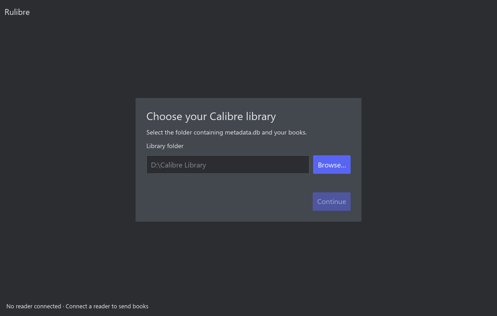
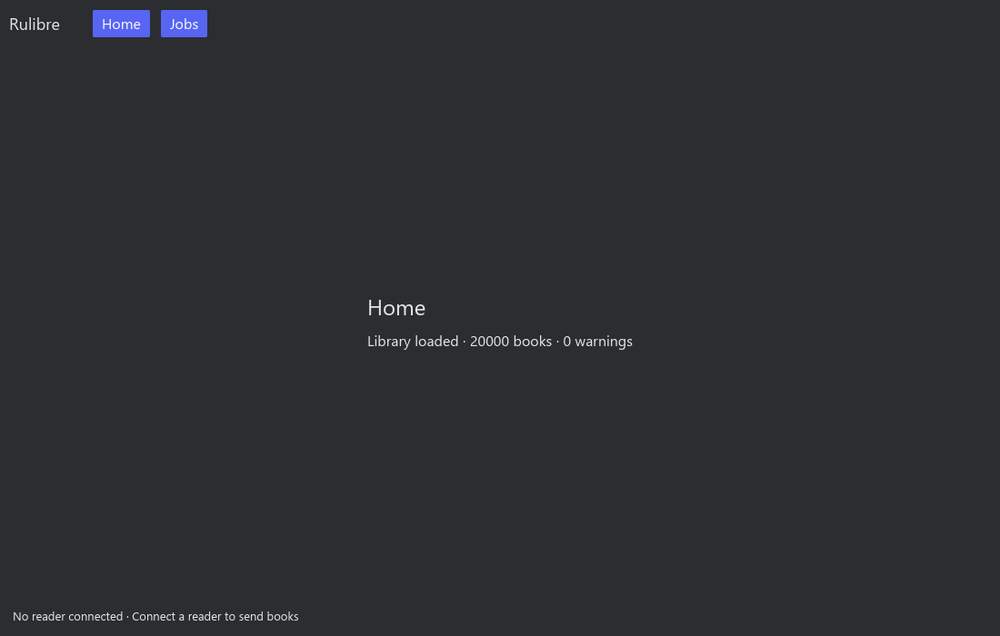

# Item №5: iced setup and background scan

Verified on 12 October 2026 on Windows build 26100, debug build, renderer scale 1.
The G1 HTML design was approved in the implementation chat before the iced work.
HTML remains a design reference; the application uses iced 0.14.

## Implemented flow

Startup loads core configuration and UI preferences asynchronously. Missing,
invalid or unavailable saved libraries open Setup. Config errors include the
config path and remain visible in the card; corrupted files are preserved until
the user chooses and saves a valid library.

Setup offers a path field, asynchronous native Browse dialog and Continue.
Typed paths use core `sanitize_path`; validation uses `is_calibre_library`.
Native picker paths retain their original path encoding. Input and Continue are
disabled while a picker, validation or save is outstanding. A save failure leaves
the previous config and active library intact and displays its cause in Setup.
The production paths are the existing core config location and sibling `ui.toml`.
`RealServices::with_paths` supplies isolated config paths for fixture runs.

After a successful save, Home starts `JobRequest::Scan` through the coordinator.
The scan is visible and cancellable in Home and in the minimal scan Jobs view.
Results populate `State.books` and warning diagnostics; failure offers Retry scan
and Choose another library. Library changes cancel the old scan; job identity
guards reject its result even if cancellation races completion. Generations guard
config, picker and validation replies. Shutdown cancels and joins core jobs.
Old scan outputs are excluded from generic result history to avoid retaining
another complete library.

The Home/Jobs navigation is a temporary way to inspect scanning. The shell,
palette and icons remain item №6, book list/grid remains №7/№9, detailed warning
display remains №11, and device detection remains №10. The bottom reader text is
a placeholder. No library writes are introduced.

## Checks

- `scripts/check-ui.ps1`: workspace formatting, locked UI build, all-target Clippy
  with warnings denied, and all-target tests passed (30 UI library tests plus
  one existing spike example test).
- Default workspace `cargo clippy --locked --all-targets -- -D warnings` and
  `cargo test --locked` passed (107 tests passed, 3 ignored).
- `git diff --check` passed.
- Tests cover first run, valid/missing/corrupt saved config, validation and config
  save failure, scan success/warnings/failure, cancellation, library switch,
  stale replies, picker cancellation and shutdown. RealServices tests use real
  config files, atomic replacement and the real scanner/coordinator on temporary
  fixtures; fixture source file contents remain unchanged after scan.

## 20,000-book window probe

Run `cargo run -p rulibre-ui --example setup_scan_probe --locked`. It creates
200 author folders with 100 book folders each and one synthetic EPUB per book.
`metadata.db` is a setup marker, not a SQLite database; the core scanner reads
the folder tree. Config and settings live outside the fixture library, inside
the temporary root. No personal config or library is read or written.

The probe opens a real iced window, renders first-run Setup, chooses the fixture
via application messages, validates/saves it and scans. It then reinitializes
application state, loads the saved config, scans again and closes the window.
The fixture is removed after services stop.

Final run ([raw output](ui-item-5/probe.txt)):

| Mode | Books | Scan to accepted result | 16 ms heartbeat events | Largest update gap | Scanning view calls |
|---|---:|---:|---:|---:|---:|
| First run after Setup | 20,000 | 2,418 ms | 150 | 24 ms | 168 |
| Saved config | 20,000 | 2,218 ms | 138 | 25 ms | 155 |

Fixture creation took 6,366 ms before opening the window. Setup reached the
iced view 54 times before the first scan. Scan timings include coordinator
polling (100 ms) and result application. Heartbeat delivery and view calls show
the event loop continued working while scanning; these are not GPU timings or
presented-frame measurements, and do not measure physical input latency.

Renderer screenshots were inspected at 1100×700. Setup text and controls fit,
and Home shows the 20,000-book result. A clipped toolbar title during transition
was fixed by giving the title container and toolbar a stable height. Screenshots
contain iced content only, excluding native window decorations.

## Remaining verification

Native Browse interaction, physical input during a scan, higher DPI, minimum-size
layout, Linux and macOS were not manually tested. The synthetic fixture is not a
personal Calibre library or physical reader. No remote CI run, commit or PR was
created for this item.
