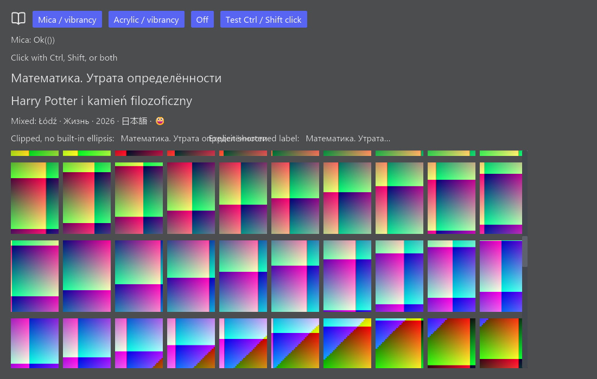

# iced 0.14 capability spike (item №2)

> **Update, 12 October 2026 (item №14):** the transparent-window / OS-blur "no-go"
> below applies to wgpu's default `DxgiFromHwnd` surface only. With a
> DirectComposition swap chain and two small patches to iced, acrylic window blur
> works on Windows 11; see [UI_BLUR.md](UI_BLUR.md). The measurements and the other
> rows of this document are unchanged.

Measured on 12 October 2026, Windows 11 build 26100, NVIDIA GeForce RTX 5060 Ti
(driver 591.86), 1100×700 logical pixels, scale factor 1. Local **debug** builds.
No Calibre library or physical reader was involved.

| Feature | Decision for v1 | Evidence / consequence |
|---|---|---|
| Transparent window + OS blur | **No-go with the tested Windows renderer configuration** | Vulkan and DX12 both expose only `Opaque` surface alpha. Effect calls succeed, but cannot establish useful background composition. Keep the production window opaque; remove Window blur from Settings and limit №14 to cover tint. |
| Cyrillic, Polish, mixed text | **Go** | Both exact strings from the plan render legibly. Advanced shaping also renders Łódź, Cyrillic, Japanese and emoji via installed fonts. Ellipsis needs a separate implementation. |
| 200 JPEG covers | **Go with background decoding, resizing, bounded caching and virtualization** | All 200 distinct JPEGs decode into handles and the grid renders/scrolls. Eager full-resolution loading is unsuitable for a large catalog. Software renderer is too slow in this lab. |
| Embedded SVG | **Go** | Lucide `book-open` renders at 28×28 in the theme text colour. Original license is included. |
| Ctrl/Shift at click time | **Go for the state/subscription approach** | Read `ModifiersChanged` including captured events, store the latest value, consume it in the button message, and reset on focus loss. Four combinations and focus loss pass the automated state test. Physical keyboard/mouse interaction remains unverified. |

The experiment is retained in
[spike_capabilities.rs](../crates/rulibre-ui/examples/spike_capabilities.rs),
with usage notes in [examples/README.md](../crates/rulibre-ui/examples/README.md).
`image` and `window-vibrancy` 0.8.1 are **dev dependencies only**; the shipped
application still uses its item №1 placeholder and opaque window.

## 1. Transparency and OS blur

The example sets `transparent: true`, a fully transparent application background
and a root fill with alpha 0.72. `window::oldest` followed by `window::run` exposes
`&dyn window::Window`, which implements `HasWindowHandle`. It can be passed
directly to `window-vibrancy`, without manually extracting an HWND or adding
unsafe code to the client.

On the **same window**, Mica → off → Acrylic → off returned `Ok(())` in all three
runs. Thus changing the OS effect does not require recreating the window at the
API level. This is **not a visual verification of OS blur**. The default Vulkan
and explicitly selected DirectX 12 surfaces both log:

```text
Available alpha modes: [Opaque]
Selected format: Bgra8Unorm with alpha mode: Auto
```

This is enough to reject shipping window blur with this configuration in v1.
It does not prove that every possible iced/winit renderer setup is incapable of
transparency. No patched compositor or custom native window setup was attempted.
The tiny-skia alternative is slow enough with these fixtures to reject it as a
substitute for the GPU renderer in this UI.

Platform outcomes:

| Platform | What was verified | Fallback / known API support |
|---|---|---|
| Windows 11 build 26100 | Runtime effect API calls; Vulkan/DX12 opaque surface capabilities; renderer content | Opaque palette in v1. Desktop blur, moving/resizing and wallpaper contrast were not visually verified. |
| Windows 10 | **Not run** | Mica is Windows 11 only. Acrylic is documented for Windows 10 1809+. The example tolerates unsupported Mica clearing so Acrylic can still be attempted; this branch was not tested on Windows 10. |
| macOS | **Not built or run in this spike** | Example uses `apply_vibrancy` with `HudWindow` material and active state; both enabled buttons exercise this same effect. No OS blur ships in v1. |
| Linux | **Not built or run in this spike** | Example returns an unsupported message and retains the flat translucent fill. Desktop composition depends on the compositor. Production uses an opaque window. |

API sources: [iced 0.14 window::run](https://docs.rs/iced/0.14.0/iced/window/fn.run.html),
[window-vibrancy 0.8.1](https://docs.rs/window-vibrancy/0.8.1/window_vibrancy/).
Surface selection and available platform settings were also checked in the
locally downloaded iced 0.14 sources.

## 2. Text, fallback, and ellipsis

The retained screenshots were inspected: `Математика. Утрата определённости`,
`Harry Potter i kamień filozoficzny` and the mixed line render without missing
glyph boxes at 100% scale. This checks the **installed Windows fonts**, not a
guarantee for other machines. DPI 150%/200% and other OS font sets remain untested.
`Shaping::Advanced` enables font fallback; later views should use it for catalog
text. `fontdb` reports a malformed face in the installed `mstmc.ttf`; rendering
still works with other fonts.

iced's text widget exposes wrapping/shaping, but no built-in ellipsis option.
The 150 px `Wrapping::None` label visibly overflows into the following text in
the lab. Setting width alone is insufficient. №7 needs width-aware truncation
at grapheme boundaries, measured with the actual font/size; explicit clipping
and a full-title tooltip should accompany it. The shortened label in the lab
is a fixed comparison string, **not** an implemented truncation algorithm.



This is an iced **renderer screenshot**. It does not include native decorations,
wallpaper, or DWM's composed blur. The black background cannot by itself verify
what the desktop compositor displays.

## 3. Images and measured cost

Fixtures are 200 different, deterministic 240×360 RGB images encoded as JPEG
at quality 85. Total JPEG bytes: **2,163,988** (2.06 MiB). Timed work is JPEG
decoding plus creation of RGBA `image::Handle`s; fixture generation/encoding is
excluded. Retained RGBA pixel data: **69,120,000 bytes (65.92 MiB)**. Handles are
created eagerly, while GPU texture upload can be lazy for visible covers.

| Backend | Decode + handles | Peak working set | Peak private bytes |
|---|---:|---:|---:|
| Default (Vulkan) | 6735.144 ms | 330,833,920 B (315.51 MiB) | 534,749,184 B (509.98 MiB) |
| DX12 | 6784.544 ms | 202,801,152 B (193.41 MiB) | 463,654,912 B (442.18 MiB) |
| tiny-skia | 6754.221 ms | 177,504,256 B (169.28 MiB) | 152,571,904 B (145.50 MiB) |

Memory is whole-process Windows working set/private bytes, sampled every 250 ms
through `System.Diagnostics.Process`; it includes fixture preparation, fonts,
renderer state and screenshots. It is not incremental cover-cache memory or
GPU VRAM, and does not establish a backend memory ranking from one run each.

The lab forces 480 redraw requests and scrolls every fifth request. Each phase
has 120 requests, discards its first 30, and measures 89 successive intervals:

| Backend | Mica mean / p95 | Off mean / p95 | Acrylic mean / p95 | Off again mean / p95 |
|---|---:|---:|---:|---:|
| Vulkan | 8.299 / 6.317 ms | 8.364 / 5.861 ms | 8.298 / 5.809 ms | 8.236 / 5.875 ms |
| DX12 | 8.491 / 6.335 ms | 8.424 / 5.868 ms | 8.431 / 5.895 ms | 8.364 / 5.858 ms |
| tiny-skia | 279.465 / 1454.838 ms | 277.390 / 1444.140 ms | 270.799 / 1391.879 ms | 279.058 / 1454.491 ms |

These are `window::frames` / `RedrawRequested` **event intervals**, a frame-cadence
proxy, not GPU render duration or proof of presented FPS. Mean exceeds p95 in
the GPU runs because a few long intervals dominate, including screenshot work
in the middle of each phase. This is a debug lab, not a release performance
budget. №9 should decode and resize off the UI thread, cache only bounded
thumbnails, and draw the visible slice; №15 still needs release profiling.

Raw stdout, renderer logs, memory samples and four screenshots per run are kept
under [Vulkan](spike-results/windows/), [DX12](spike-results/windows-dx12/) and
[tiny-skia](spike-results/windows-software/). Logs retain their original local
output paths. No physical reader or real library performance is claimed.

## 4. SVG icons

Lucide `book-open.svg` is embedded using `include_bytes!`, passed to
`svg::Handle::from_memory`, and coloured via `svg::Style.color` from the dark
theme palette. The 28×28 result is legible in the inspected PNGs from all three
renderers. More sizes, hover states and DPI levels are left to №6/№15.

Source: [Lucide book-open](https://github.com/lucide-icons/lucide/blob/main/icons/book-open.svg).
The original [Lucide license](https://github.com/lucide-icons/lucide/blob/main/LICENSE)
was downloaded on 12 October 2026 and preserved verbatim with the upstream
Feather notices in [LUCIDE-LICENSE](../crates/rulibre-ui/examples/assets/LUCIDE-LICENSE).

## 5. Modifiers and click events

Mouse/button messages do not carry keyboard modifiers. The lab uses
`iced::event::listen_with`, rather than `listen`, to receive `ModifiersChanged`
regardless of whether a widget captured the event. It stores current Ctrl/Shift,
reads that state for `Message::Click`, and clears it on `Window::Unfocused` to
avoid a stuck modifier when focus moves away. The exact API path was verified
against the local iced event subscription source.

The automated test checks none, Ctrl, Shift, Ctrl+Shift and focus-loss reset.
It does **not** synthesize native keyboard/mouse events. Real Ctrl/Shift clicks,
including release outside the window, remain a manual check for №7/№15.

## Reproduction and checks

```powershell
./scripts/measure-ui-spike.ps1 -Backend default -OutputDirectory target/spike-vulkan
./scripts/measure-ui-spike.ps1 -Backend dx12 -OutputDirectory target/spike-dx12
./scripts/measure-ui-spike.ps1 -Backend software -OutputDirectory target/spike-software
cargo run -p rulibre-ui --example spike_capabilities --locked
```

All local checks passed: `cargo fmt --all -- --check`,
`cargo clippy --locked --all-targets -- -D warnings`, `cargo test --locked`,
and `scripts/check-ui.ps1` (UI locked build, Clippy all targets, tests all targets,
workspace formatting). The example's one modifier test passes. This spike has
not been pushed, committed or run in remote CI; macOS/Linux are not claimed as
verified. The existing CI script now runs example tests without opening a window.

The measurement script itself was exercised with the default backend after the
final build. The updated HTML mockup was opened in the in-app browser: Home
loads and Settings shows Cover tint, Prefer KEPUB and Library folder without the
Window blur row. A [Settings screenshot](spike-results/mockup-settings.png) is
retained. The temporary browser tab and local server were closed after checking.
